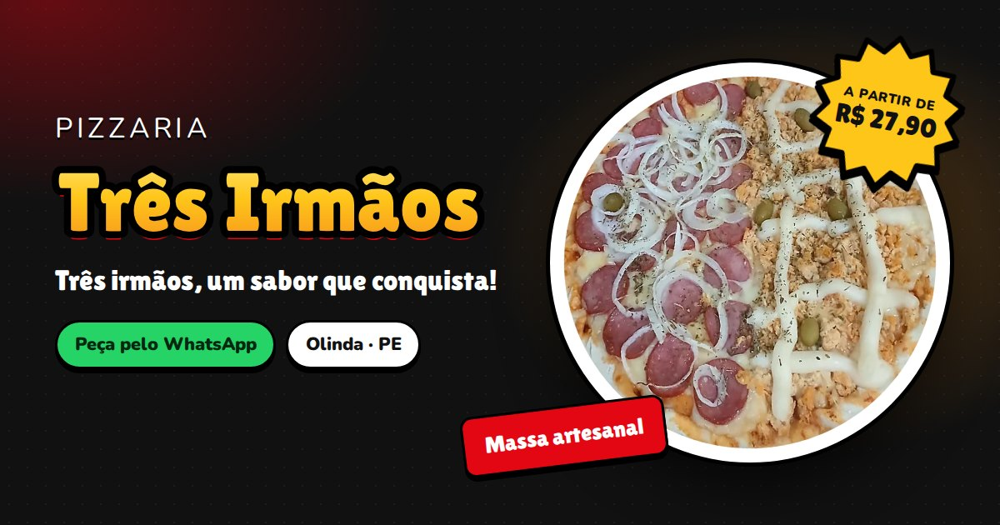
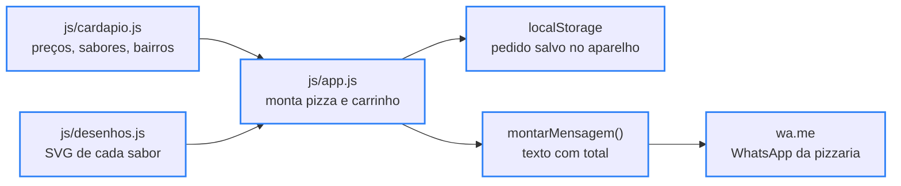

<div align="center">

# 🍕 Pizzaria Três Irmãos

**Acesse o site:** [briandevbr.github.io/Pizzaria3Irmaos](https://briandevbr.github.io/Pizzaria3Irmaos/)

[](#-como-funciona)

[](#️-tecnologias-usadas)

`HTML · CSS · JavaScript puro · 0 dependências · GitHub Pages · licença não especificada`

</div>

Site da Pizzaria Três Irmãos (Olinda-PE). O cliente monta o pedido no site — inteira ou meio a meio, borda recheada, bebidas, entrega ou retirada — e envia tudo pronto pro WhatsApp da pizzaria, sem app de terceiros no meio e sem comissão por pedido.

---

## 📑 Sumário

- [🗂️ Estrutura do Projeto](#️-estrutura-do-projeto)
- [🗂️ Estrutura do Projeto - tree](#️-estrutura-do-projeto---tree)
- [🖼️ Prévia](#️-prévia)
- [📈 Impacto de negócio](#-impacto-de-negócio)
- [🔄 Como funciona](#-como-funciona)
- [🧭 Mapa do site](#-mapa-do-site)
- [🍕 O cardápio em números](#-o-cardápio-em-números)
- [🖼️ Imagens dos sabores](#️-imagens-dos-sabores)
- [🛠️ Onde mudar as coisas](#️-onde-mudar-as-coisas)
- [⚙️ Tecnologias usadas](#️-tecnologias-usadas)
- [🚀 Como rodar](#-como-rodar)
- [✨ Funcionalidades](#-funcionalidades)
- [🤝 Contribuindo](#-contribuindo)
- [📄 Licença](#-licença)

---

## 🗂️ Estrutura do Projeto

| Caminho | Descrição |
|---|---|
| `index.html` | Página única: topo, herói, "como pedir", cardápio (preenchido pelo JS), contato com mapa, rodapé e os dois painéis (montar pizza e seu pedido). Traz também o SEO: Open Graph, `canonical` e JSON-LD `Restaurant` |
| `css/estilo.css` | Todo o visual: tema escuro, cards dos sabores, painéis em "folha" que sobem da base, animações e ajustes para celular |
| `js/cardapio.js` | Os dados do negócio: número do WhatsApp, categorias, 19 sabores com preço, bordas, bebidas, bairros e taxas, formas de pagamento e horário. É o único arquivo a editar para mudar preço |
| `js/desenhos.js` | Gera em SVG as pizzas (inteira e meio a meio), as bordas, as garrafas e os enfeites do topo. Cada sabor tem uma "receita" de ingredientes; sabor sem receita ganha um desenho genérico |
| `js/app.js` | A lógica: monta o cardápio, o painel de montagem, o carrinho salvo no aparelho, o "Aberto agora", a validação do formulário e a mensagem do WhatsApp. Troca foto que não carregou pelo desenho do sabor |
| `img/logo.png` | Logo da pizzaria (400×400, fundo transparente) |
| `img/foto-portuguesa.webp` | Foto real da Portuguesa, o único sabor com foto hoje |
| `img/foto-meio-a-meio.webp` | Foto do herói: meio calabresa, meio frango com catupiry |
| `img/compartilhar.jpg` | Imagem de 1200×630 que aparece ao compartilhar o link (WhatsApp, redes sociais) |
| `img/favicon.png`, `img/icone-*.png` | Favicon, ícone do iPhone (`apple-touch-icon`) e ícones 192/512 do manifest, incluindo a versão `maskable` |
| `manifest.webmanifest` | Nome, cores e ícones usados quando o cliente adiciona o site à tela inicial |
| `.nojekyll` | Faz o GitHub Pages publicar os arquivos como estão, sem passar pelo Jekyll |
| `.gitignore` | Ignora lixo de sistema e editor, `node_modules`, `.env` e anotações privadas do projeto |
| `README.md` | Esta documentação |

---

## 🗂️ Estrutura do Projeto - tree

```
🗂️
├── 📁 css
│  └── 🎨 estilo.css
├── 📁 img
│  ├── 🖼️ compartilhar.jpg
│  ├── 🖼️ favicon.png
│  ├── 🖼️ foto-meio-a-meio.webp
│  ├── 🖼️ foto-portuguesa.webp
│  ├── 🖼️ icone-192.png
│  ├── 🖼️ icone-512.png
│  ├── 🖼️ icone-app.png
│  ├── 🖼️ icone-mascara-512.png
│  └── 🖼️ logo.png
├── 📁 js
│  ├── ⚙️ app.js
│  ├── 📈 cardapio.js
│  └── ⚙️ desenhos.js
├── 🔧 .gitignore
├── 🔧 .nojekyll
├── 🌐 index.html
├── 🔧 manifest.webmanifest
└── 🇧🇷 README.md
```

---

## 🖼️ Prévia

<div align="center">

[](https://briandevbr.github.io/Pizzaria3Irmaos/)

<sub>Imagem de compartilhamento do site (<code>img/compartilhar.jpg</code>). Clique para abrir o site publicado.</sub>

</div>

---

## 📈 Impacto de negócio

O site resolve três coisas para a pizzaria: o pedido chega **completo e com total calculado** no WhatsApp (menos idas e vindas na conversa), **não paga comissão** de marketplace e deixa a pizzaria **encontrável no Google** com dados estruturados de restaurante (endereço, horário, faixa de preço, bairros atendidos).

O que dizem as pesquisas sobre presença digital em pequenos negócios e no food service:

| Indicador | Dado | Fonte |
|---|---|---|
| Peso das vendas digitais no faturamento | Em média, **mais de 40%** do faturamento de MEIs, micro e pequenas empresas | [Sebrae — Transformação Digital nos Pequenos Negócios](https://agenciasebrae.com.br/inovacao-e-tecnologia/vendas-digitais-sao-responsaveis-por-mais-de-40-do-faturamento-dos-pequenos-negocios/) (6ª edição, 6.247 empreendedores, coleta jul–set/2023) |
| Pequenos negócios que vendem por canais digitais | Cerca de **70%**, e o WhatsApp é o canal mais usado (**56%**), à frente de Instagram (43%) e Facebook (23%) | [Sebrae — mesma pesquisa](https://agenciasebrae.com.br/inovacao-e-tecnologia/vendas-digitais-sao-responsaveis-por-mais-de-40-do-faturamento-dos-pequenos-negocios/) |
| WhatsApp no faturamento do delivery de bares e restaurantes | **26%**, atrás só dos marketplaces (54%); app/site próprio responde por 12% e telefone por 8% | [Abrasel, pesquisa 2025 com 2.176 donos de estabelecimentos — via Mercado&Consumo](https://mercadoeconsumo.com.br/16/03/2025/foodservice/whatsapp-representa-26-do-faturamento-com-delivery-em-bares-e-restaurantes/) |
| Efeito da reputação online na receita | Cada **+1 estrela** na avaliação online levou a **+5% a 9% de receita** em restaurantes independentes (sem efeito em redes) | [Michael Luca, Harvard Business School — "Reviews, Reputation, and Revenue: The Case of Yelp.com"](https://papers.ssrn.com/abstract=1928601) · [resumo da HBS](https://www.library.hbs.edu/working-knowledge/the-yelp-factor-are-consumer-reviews-good-for-business) |
| Comissão que o pedido direto deixa de pagar | **12%** (plano em que a loja entrega) a **23%** (plano com entregador do app) por pedido, mais **3,2%** sobre pagamento online | [Serasa — valores de referência dos planos do iFood](https://www.serasa.com.br/blog/abrir-loja-no-ifood/) (as taxas variam por região; confirme no Portal do Parceiro iFood) |

**Na conta da Três Irmãos:** numa Portuguesa de R$ 33,90, a comissão de marketplace seria de **R$ 4,07 (12%) a R$ 7,80 (23%)** por pizza, antes da taxa de pagamento online. Pedido que chega pelo site vai direto pro WhatsApp e esse valor fica no caixa da pizzaria.

> Esses números descrevem o mercado, não são medições deste site. Para medir o efeito real, vale anotar quantos pedidos por semana chegam com a mensagem "*NOVO PEDIDO — Pizzaria Três Irmãos*" e comparar com o período anterior ao site.

---

## 🔄 Como funciona



<sub>Borda azul = pronto</sub>

O site é estático: não tem servidor nem banco de dados. Os três scripts são carregados em ordem — dados (`cardapio.js`), desenhos (`desenhos.js`) e lógica (`app.js`) — e todo o HTML do cardápio é gerado a partir dos dados. O preço do meio a meio é o do sabor mais caro, a borda soma R$ 8,00 e o carrinho guarda tudo em centavos inteiros para não errar arredondamento.

A parte mais interessante é o `desenhos.js`: cada pizza é desenhada camada por camada (massa, molho, queijo, ingredientes, orégano) a partir do **id do sabor**, que vira a semente de um gerador pseudoaleatório. Por isso a mesma pizza sai sempre igual, em qualquer aparelho:

```text
Entrada:                     Desenhos.pizza('calabresa'), chamado em vários lugares da página
Math.random():               cada render espalha os ingredientes de um jeito diferente   ❌
sorteio(semente('calabresa')): sempre o mesmo desenho, no card, no painel e no carrinho   ✅
```

E isto é o que a pizzaria recebe no WhatsApp (pedido de teste gerado pelo próprio site):

```text
*NOVO PEDIDO — Pizzaria Três Irmãos*

*Cliente:* Maria

*Itens:*
1) *1x Pizza meio a meio*
   ½ Calabresa + ½ Frango com Catupiry
   Borda recheada de Catupiry
   R$ 41,90
2) *1x Coca-Cola 2L*
   R$ 14,00

*Subtotal:* R$ 55,90
*Entrega:* Casa Caiada (taxa R$ 8,00)
*Endereço:* Rua Exemplo, 100
*Pagamento:* Pix

*TOTAL: R$ 63,90*
```

---

## 🧭 Mapa do site

É uma página só; cada parte tem uma âncora que pode ser usada em links diretos (ex.: `.../Pizzaria3Irmaos/#cardapio`).

| Âncora / elemento | O que tem |
|---|---|
| `#inicio` | Herói: nome, slogan, selo "a partir de R$ 27,90", status "Aberto agora / Fechado" e a foto meio a meio |
| `#cardapio` | Cardápio com abas que acompanham a rolagem |
| `#cat-salgadas` · `#cat-especiais` · `#cat-doces` | Sabores de cada categoria, agrupados por preço |
| `#cat-bordas` | Bordas recheadas (+ R$ 8,00 na pizza) |
| `#cat-bebidas` | Bebidas de 1L e 2L, adicionadas com um toque |
| `#contato` | Endereço, horário da semana, pagamento, bairros com taxa, mapa, Instagram e WhatsApp |
| `#painel-pizza` | Painel de montagem: inteira ou meio a meio, borda e quantidade |
| `#painel-pedido` | Carrinho, dados de entrega/retirada, pagamento e botão de enviar pelo WhatsApp |

Os painéis entram no histórico do navegador, então o botão **Voltar** do celular fecha o painel em vez de sair do site.

---

## 🍕 O cardápio em números

Contado a partir de `js/cardapio.js`:

| Item | Conteúdo |
|---|---|
| Pizzas salgadas | 9 sabores — 4 a R$ 28,90 e 5 a R$ 33,90 |
| Pizzas especiais | 4 sabores — 2 a R$ 34,90 e 2 a R$ 40,00 |
| Pizzas doces | 6 sabores a R$ 27,90 |
| Tamanho | Uma só, com 8 fatias |
| Bordas recheadas | 4 (Catupiry, Cheddar, Mussarela, Cream Cheese) a + R$ 8,00 |
| Bebidas | Antarctica (1L R$ 9,00 · 2L R$ 13,00) e Coca-Cola (1L R$ 10,00 · 2L R$ 14,00) |
| Entrega | 6 bairros de Olinda, taxa de R$ 5,00 a R$ 8,00 (valores provisórios); retirada sem taxa |
| Pagamento | Pix, cartão de débito, cartão de crédito e dinheiro (com troco) |
| Horário | Terça a domingo, 17h às 23h; segunda fechado |

---

## 🖼️ Imagens dos sabores

Dos 19 sabores, **1 tem foto oficial** e **18 usam um desenho SVG** gerado no navegador, no mesmo estilo "adesivo" do site (contorno preto, borda branca e brilho). Nenhuma pizza aparece sem imagem.

| Categoria | Com foto oficial | Sem foto → desenho SVG |
|---|---|---|
| Salgadas (9) | Portuguesa | Mussarela, Calabresa, Marguerita, Frango, Galinha Caipira, Frango com Catupiry, Frango com Cheddar, Calabresa com Catupiry |
| Especiais (4) | — | Bacon, Atum, Quatro Queijos, Frango com Bacon |
| Doces (6) | — | Cartola, Brigadeiro, Sonho de Valsa, Doce de Leite, Paçoca, M&M's |

Bordas e bebidas são sempre desenhadas. A pizza meio a meio também é sempre desenho, mesmo quando um dos sabores tem foto: as duas metades são recortadas e unidas no SVG.

Cada sabor passa por esta ordem até encontrar uma imagem:

1. **Foto** (`foto` no sabor, em `cardapio.js`). Enquanto ela carrega, o círculo já aparece na cor da massa.
2. **Foto que não carregou** (arquivo apagado ou nome errado): o `app.js` troca na hora pelo desenho do sabor.
3. **Desenho da receita do sabor** (`RECEITAS` em `desenhos.js`).
4. **Sabor novo sem receita**: pizza de queijo genérica, sem ingrediente que o sabor talvez não leve, e um aviso no console do navegador lembrando de criar a receita.

Para trocar o desenho de um sabor por foto: salve a imagem quadrada em `img/` (de preferência `.webp`) e adicione `foto: 'img/arquivo.webp'` ao sabor, como na Portuguesa.

---

## 🛠️ Onde mudar as coisas

| O quê | Onde |
|---|---|
| Preços, sabores, bordas e bebidas | `js/cardapio.js` |
| Taxa de entrega de cada bairro | `js/cardapio.js` → `bairros` |
| Meio a meio misturando salgada com doce | `js/cardapio.js` → `meioAMeioSalgadaComDoce` |
| Horário (usado no "Aberto agora") | `js/cardapio.js` → `horario` |
| Número que recebe os pedidos | `js/cardapio.js` → `whatsapp` (55 + DDD + número, só dígitos) |
| Foto de um sabor | `js/cardapio.js` → `foto: 'img/arquivo.webp'` no sabor |
| Desenho de um sabor novo | `js/desenhos.js` → `RECEITAS` |
| Logo | trocar o arquivo `img/logo.png` (quadrado, fundo transparente) |

Endereço, horário escrito e bairros também aparecem no `index.html` (texto da seção de contato e JSON-LD) — se mudarem, atualize lá também.

---

## ⚙️ Tecnologias usadas

- **HTML5** — página única com diálogos acessíveis (`aria-modal`, `inert`), [Open Graph](https://ogp.me/) para a prévia do link e [JSON-LD `Restaurant`](https://schema.org/Restaurant) para o Google
- **CSS3** — layout responsivo, animações e respeito a [`prefers-reduced-motion`](https://developer.mozilla.org/pt-BR/docs/Web/CSS/@media/prefers-reduced-motion)
- **JavaScript puro**, sem framework e sem etapa de build:
  - [`Intl.NumberFormat`](https://developer.mozilla.org/pt-BR/docs/Web/JavaScript/Reference/Global_Objects/Intl/NumberFormat) para os preços em reais
  - [`Intl.DateTimeFormat`](https://developer.mozilla.org/pt-BR/docs/Web/JavaScript/Reference/Global_Objects/Intl/DateTimeFormat) com fuso `America/Recife` para o "Aberto agora"
  - [`localStorage`](https://developer.mozilla.org/pt-BR/docs/Web/API/Window/localStorage) para guardar o pedido no aparelho
  - [`IntersectionObserver`](https://developer.mozilla.org/pt-BR/docs/Web/API/Intersection_Observer_API) para as abas e as animações de entrada
  - [History API](https://developer.mozilla.org/pt-BR/docs/Web/API/History_API) para o botão Voltar fechar os painéis
- **SVG gerado por JavaScript** — pizzas, bordas, garrafas e enfeites
- **Google Fonts** — [Lilita One](https://fonts.google.com/specimen/Lilita+One) nos títulos e [Nunito](https://fonts.google.com/specimen/Nunito) no texto
- **Google Maps** (iframe) — mapa da seção de contato
- **WhatsApp** (`wa.me`) — destino do pedido
- **[GitHub Pages](https://docs.github.com/pt/pages)** — hospedagem do site

---

## 🚀 Como rodar

Pré-requisito: um navegador. Não há nada para instalar.

```bash
git clone https://github.com/briandevbr/Pizzaria3Irmaos.git
cd Pizzaria3Irmaos
```

Depois é só abrir o `index.html` no navegador. Se preferir servir por HTTP (mais próximo do site publicado):

```bash
python3 -m http.server 8000
# abra http://localhost:8000
```

O cardápio aparece com as abas Salgadas, Especiais, Doces, Bordas e Bebidas. Toque num sabor para montar a pizza; a barra "Ver meu pedido" surge no rodapé com o total.

### Publicar (GitHub Pages)

1. No plano grátis do GitHub, o repositório precisa ser **público** (Settings → General → Danger Zone → Change visibility).
2. Settings → Pages → *Deploy from a branch* → branch `main`, pasta `/ (root)` → Save.
3. Em 1–2 minutos o site fica em [briandevbr.github.io/Pizzaria3Irmaos](https://briandevbr.github.io/Pizzaria3Irmaos/).

Cada commit na `main` atualiza o site sozinho.

---

## ✨ Funcionalidades

**Progresso: 13 de 17 etapas concluídas**

- [x] Cardápio gerado a partir de um único arquivo de dados (19 sabores em 3 categorias)
- [x] Montagem da pizza inteira ou meio a meio, com preço do sabor mais caro
- [x] Borda recheada e quantidade por item
- [x] Bebidas de 1L e 2L, com sugestão no carrinho quando o pedido ainda não tem bebida
- [x] Carrinho salvo no aparelho, com checagem dos dados salvos ao reabrir
- [x] Entrega com taxa por bairro ou retirada sem taxa
- [x] Pagamento por Pix, débito, crédito ou dinheiro, com cálculo de troco
- [x] Validação do formulário antes de enviar
- [x] Mensagem do pedido formatada e enviada pelo WhatsApp
- [x] Status "Aberto agora / Fechado" no fuso de Recife
- [x] Desenho automático para sabores sem foto e troca automática de foto que não carrega
- [x] Acessibilidade: link "Pular para o cardápio", foco preso nos painéis, Esc e Voltar fecham, respeito a "reduzir movimento"
- [x] SEO local: JSON-LD de restaurante, Open Graph, `canonical` e manifest com ícones
- [ ] Confirmar a taxa de cada bairro com a pizzaria (os valores atuais são provisórios)
- [ ] Confirmar se o meio a meio pode juntar salgada com doce (hoje: não pode)
- [ ] Confirmar ingredientes de cada sabor, pedido mínimo e tempo de entrega
- [ ] Fotos reais dos 18 sabores que hoje usam desenho

---

## 🤝 Contribuindo

Projeto feito para a Pizzaria Três Irmãos, sem processo de contribuição externa no momento. Sugestões e correções são bem-vindas via [issues](https://github.com/briandevbr/Pizzaria3Irmaos/issues).

---

## 📄 Licença

Licença não especificada (o repositório não tem arquivo `LICENSE`).

---

<div align="center">
  <sub>Feito por <a href="https://github.com/briandevbr">David Brian</a> · site de pedidos da Pizzaria Três Irmãos, Olinda-PE</sub>
</div>
